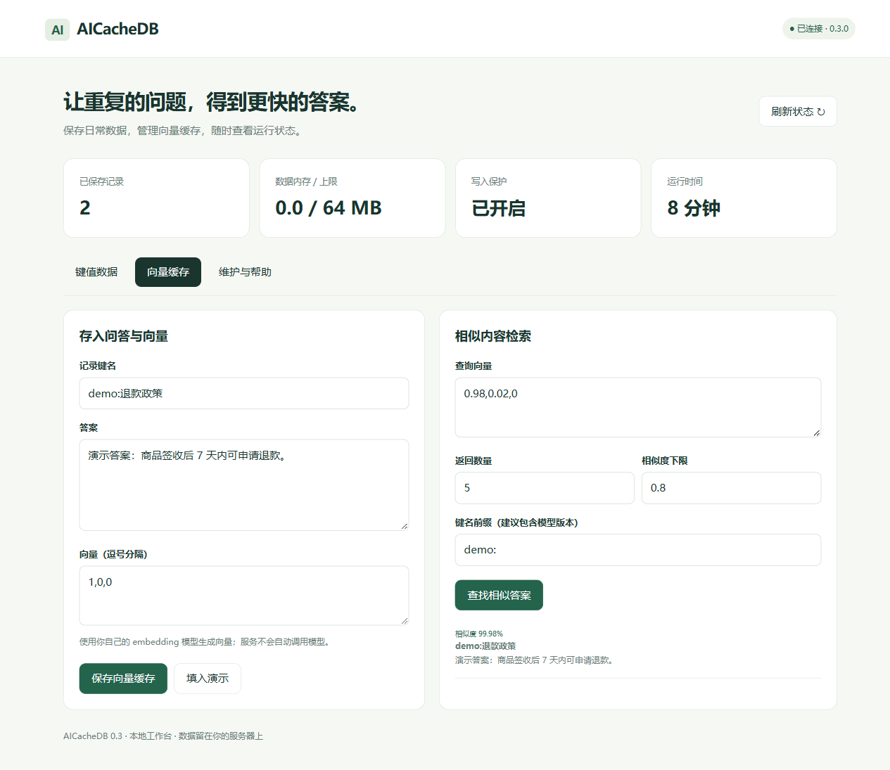

# AICacheDB

**轻量、本地优先的键值与向量缓存。保存数据、找回相似答案，在浏览器里完成日常操作。**

0.3 日常版以小规模单机使用为目标：普通 Linux / WSL、C 编译器和 make 即可构建；Python 3.9+ 提供无第三方依赖的客户端与工作台。原来的 epoll / NtyCo / io_uring、RDMA/XDP 与 HNSW 研究实现仍保留在实验构建中。



## 三分钟开始

Linux / WSL 上安装 GCC、make、Python 3，然后：

```sh
git clone --branch codex/daily-use https://github.com/bzanniupoiiu/AICacheDB.git
cd AICacheDB
python3 tools/start.py
```

打开终端打印的 `http://127.0.0.1:8099/#...` 链接，即可保存键值、浏览记录、写入向量、搜索相似答案、整理日志和生成备份。链接中包含本次控制台的访问 token，请保留给自己。Ctrl+C 同时停止数据库与工作台。默认 127.0.0.1:8888、64 MiB 数据预算、128 连接，数据保存在 `./data`。

只运行数据库：

```sh
make
./bin/kvstore -c config.example.conf
```

另一终端验证：

```sh
python3 tools/client.py PING
python3 tools/client.py SET notes:today '今天的第一条笔记' EX 3600
python3 tools/client.py GET notes:today
```

## Windows 访问你的 Linux 主机

数据库在主机运行后，在 Windows 终端保持以下隧道开启：

```powershell
ssh -N -L 18888:127.0.0.1:8888 raoyipeng@192.168.32.129
```

另开终端，在本项目目录运行：

```powershell
python tools/console.py --port 18888
```

打开打印的本机链接。其他使用者替换 SSH 用户和地址即可。数据库与工作台都不需要直接暴露到公网；从机关闭不影响单机使用。

## 接入 Python 应用

```python
from tools.client import Client

with Client() as db:
    db.set("notes:today", "你好，AICacheDB", ttl=3600)
    print(db.get("notes:today"))

    # 演示向量。实际应用需使用同一 embedding 模型生成文档和查询向量。
    db.vset("demo:v1:refund", "签收后 7 天内可申请退款。", [1, 0, 0], ttl=3600)
    hits = db.search([0.98, 0.02, 0], topk=3, threshold=0.8, prefix="demo:v1:")
    print(hits)
```

二进制数据使用 `Client(decode=False)`，键值可包含 NUL 或换行。密码从环境读取时显式传入 `password=os.environ.get("AICACHEDB_PASSWORD")`；命令行和控制台会自动读取该变量。客户端不自动重试写入，也不要跨线程共用同一个连接。

也可以使用 `redis-cli -h 127.0.0.1 -p 8888` 发送支持的命令。协议与 Redis 部分兼容，**不是 Redis 的完整替代品**。[查看命令列表与限制](docs/commands.md)。

## 这版解决了什么

- **安装更轻**：默认运行不依赖 liburing、RDMA、jemalloc、NtyCo 或内核扩展。
- **保存有明确保证**：成功回复前日志已完成 fdatasync；记录包含校验和，损坏文件拒绝启动；绝对 TTL 在重启后继续生效。
- **内存更可控**：连接缓冲按需增长，数据设置容量上限；向量覆盖会释放旧对象，不积累墓碑。
- **使用更直接**：浏览器工作台、中文操作提示、Python 客户端、命令行、启动器、配置示例、Docker 和 systemd 示例。
- **检索可验证**：精确余弦相似度、稳定排序、维度校验、前缀过滤，支持更新、删除和过期。
- **维护有入口**：INFO、SCAN、一致备份、原子日志整理；构建清理不再删除用户数据。

## 边界

这是允许回源重建的缓存，适合个人与小团队使用。精确向量查询复杂度为 O(N×维度)，默认从 1 万条以内的数据集评估，实际容量和延迟需按你的机器测试。为了清晰的可靠性，每次写入同步落盘，写吞吐可能低于原来异步模式的跑分。

没有自动调用 embedding 模型、自动主从切换、集群分片、用户级 ACL 或租户权限隔离。PREFIX 只能区分逻辑集合。单机故障时应用要能回源；不要把这里当作订单或账户的唯一数据来源。新运行时日志格式与旧版不同，旧数据目录不会自动迁移。

## 维护与开发

- [配置、备份、恢复、Docker、升级与旧版本共存](docs/operations.md)
- [全部命令、响应与容量限制](docs/commands.md)
- [原研究版说明与历史性能数据](docs/experimental.md)
- [本次验证记录](docs/validation.md)

```sh
make test       # 功能与故障回归
make sanitize   # ASan + UBSan 检查，需要 Linux / GCC
make clean      # 只删构建产物，保留数据
make experimental  # 输出 bin/kvstore-experimental，需原来的扩展依赖
```

提交问题时请附版本、操作系统、复现步骤和脱敏后的报错。不要提交访问密码、原始问答数据、向量数据或备份。项目自身授权范围仍需维护者明确；第三方代码的许可证保留在对应目录中。
